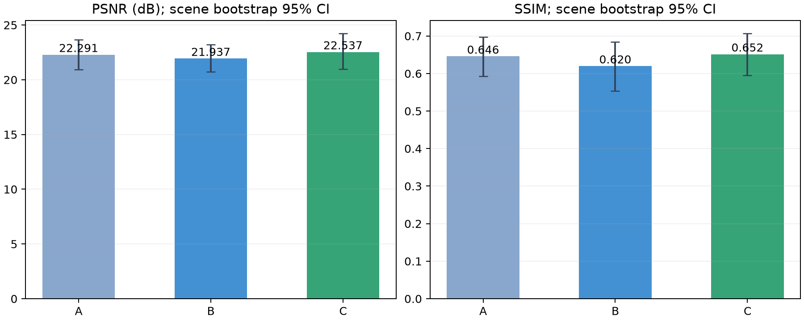
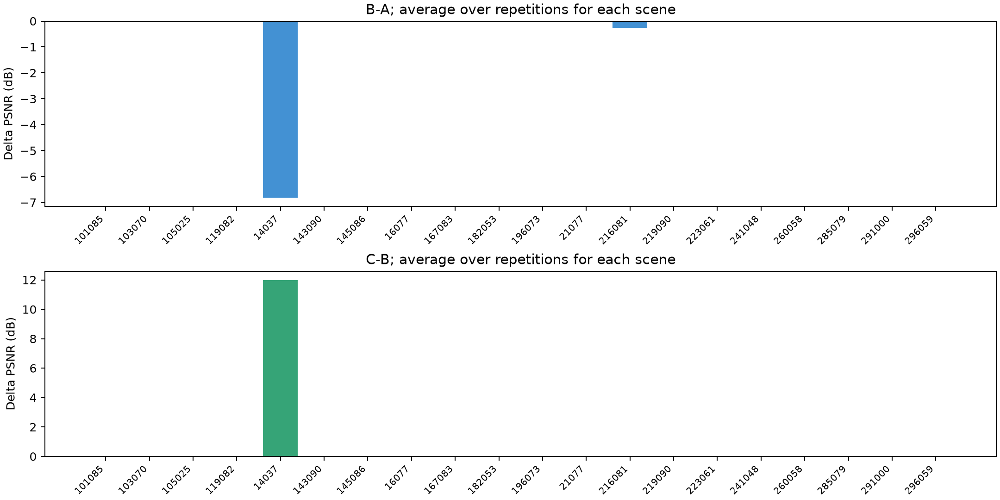
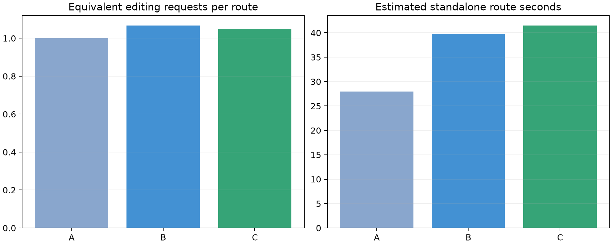
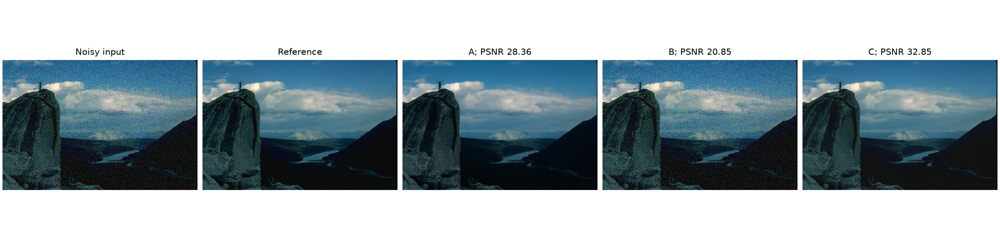
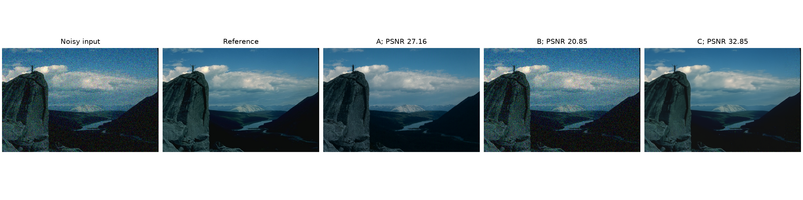
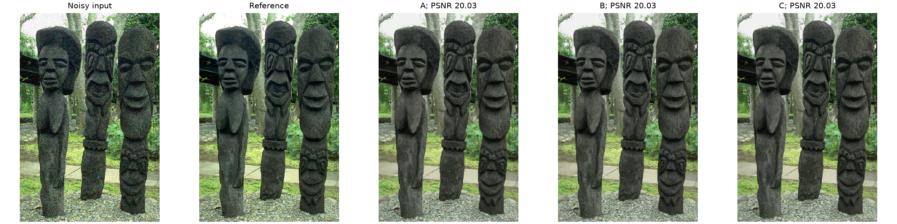

# 实验二：单次编辑、验证重试与工具回退

数据：CBSD68_25，20 个场景，每场景 3 次。
已完成 60/60 个三组配对试次；执行失败 0 个。

A：分析后单次编辑；B：结构与效果验证、最多两次编辑；C：B 的规则加适用工具回退。三组共用首次候选，相同输入、指令与检查的模型操作在试次内复用。

本轮复用 A 的退化分析与首次候选，B/C 按本轮源码快照重新执行验证、重试和工具回退。A 的生成配置见 baseline_protocol.json，本轮配置见 protocol.json。

## 最终输出质量

| 组别 | 已完成输出 / 指标有效 | 场景数 | 平均 PSNR | 平均 SSIM | ΔPSNR | ΔSSIM | PSNR 下降试次 | 返回输入图 |
| --- | --- | --- | --- | --- | --- | --- | --- | --- |
| A | 60 / 60 | 20 | 22.2907 | 0.6458 | 1.8005 | 0.2164 | 16/60 | 0 |
| B | 60 / 60 | 20 | 21.9367 | 0.6198 | 1.4465 | 0.1904 | 17/60 | 3 |
| C | 60 / 60 | 20 | 22.5368 | 0.6515 | 2.0466 | 0.2221 | 17/60 | 0 |

先对同场景重复取平均，再对场景平均。Δ 指标相对于各自退化输入。原图回退按实际输出参与评价。

## 逐场景配对差值

| 比较 | 配对场景 / 试次 | 平均 ΔPSNR | PSNR 差值 95% 区间 | 平均 ΔSSIM | 胜 / 平 / 负场景 |
| --- | --- | --- | --- | --- | --- |
| B-A | 20 / 60 | -0.3539 | [-1.0485, 0.0000] | -0.0259 | 0 / 18 / 2 |
| C-B | 20 / 60 | 0.6000 | [0.0000, 1.8001] | 0.0317 | 1 / 19 / 0 |

置信区间按场景进行 2000 次配对 bootstrap，种子 20261112。

## 调用与时间

| 组别 | 独立执行等效编辑请求 | 等效 VLM 请求 | 工具启动 | 平均等效流程秒数 |
| --- | --- | --- | --- | --- |
| A | 60 | 60 | 0 | 27.96 |
| B | 64 | 124 | 0 | 39.83 |
| C | 63 | 126 | 3 | 41.47 |

实际发送：编辑 4 次，VLM 67 次；实际工具启动 3 次。
等效计数包含复用调用；实际请求只按 api_request 事件统计。等效耗时以实测流程时间补回复用操作原耗时，并扣除工具排队时间，是独立执行时间的估计。指标计算与绘图不计入修复流程。

## 评价规则

- 完整输出与干净参考图比较，RGB、data_range=255，SSIM 使用 7×7 窗、彩色通道和样本协方差。
- 宽高比相对误差小于 1% 后，统一用 LANCZOS 映射到参考尺寸；原始输出和映射记录同时保存。宽高比失败的指标留空并计入无效输出。
- source_snapshot、protocol.json、manifest.json 固定源码、配置、样本与哈希；每试次 shared_operations.json 记录复用来源。
- 人工评价已完成 62/63 张独立输出，详见 [人工复核报告](supplement/human_review_report.md)。

## 图表

## 案例

按 C−B 的 PSNR 差值选取最高的两个试次和最低的一个试次，重复案例去重。

<!-- supplement-link -->

补充评价见 [LPIPS、挽救率与内容复核](supplement/report.md)。
