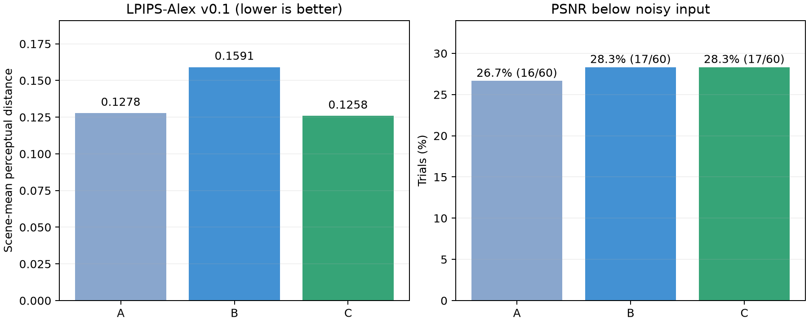

# 实验二补充评价

汇总本轮 180 份分组输出的感知质量、工具补救、质量下降情况和人工标注。

## 感知质量：LPIPS

LPIPS-Alex v0.1 使用 ImageNet 预训练 AlexNet 和作者学习权重。RGB 映射到 [-1,1]，float32、CPU、eval 模式，与 PSNR/SSIM 共用评价副本和尺寸。数值越低越接近参考图。

| 组别 | 有效输出 / 场景 | 平均 LPIPS ↓ | 相对输入的 LPIPS 改善 ↑ | LPIPS 比输入更差的次数 |
| --- | --- | --- | --- | --- |
| A | 60 / 20 | 0.1278 | 0.3369 | 2 |
| B | 60 / 20 | 0.1591 | 0.3056 | 2 |
| C | 60 / 20 | 0.1258 | 0.3389 | 2 |

同场景先平均三次重复，再平均场景。改善量为输入 LPIPS 减去输出 LPIPS。

| 比较 | 平均 LPIPS 差值（负值更好） | 95% 场景 bootstrap 区间 | 胜 / 平 / 负场景 |
| --- | --- | --- | --- |
| B-A | 0.0314 | [0.0000, 0.0941] | 0 / 18 / 2 |
| C-B | -0.0333 | [-0.0999, 0.0000] | 1 / 19 / 0 |

## 工具补救与质量下降统计

- B 未接受的试次：3。其中 C 接受且最终 PSNR、SSIM 同时高于 B 的试次：3。
- B 未接受试次的挽救率：100.00%；占全部试次比例：5.00%。
- C 相比 B 双指标更好 / 更差 / 相同：3 / 0 / 57。

| 组别 | PSNR 下降次数 / 有效试次 | 下降超过 1 dB | 最差 ΔPSNR | 最差 10% 的平均 ΔPSNR |
| --- | --- | --- | --- | --- |
| A | 16 / 60 | 10 | -4.3523 | -3.9775 |
| B | 17 / 60 | 10 | -4.3523 | -3.9775 |
| C | 17 / 60 | 10 | -4.3523 | -3.9775 |

## 人工内容标注

180 份输出去重为 63 个场景—输出组合，匿名编号并隐藏组别；当前已标注 62 个。
同一输出的标签按关联关系回填到各组。标记率为 content_error=yes /（yes＋no），无法确认和待复核单列。人工记录包含细节观察，系统按修复要求判断主要内容、构图和明显伪影。

| 组别 | 错误标记 | 无明显错误 | 无法确认 | 待复核 | 已明确判定 | 标记率 |
| --- | --- | --- | --- | --- | --- | --- |
| A | 5 | 55 | 0 | 0 | 60 / 60 | 8.33% |
| B | 5 | 54 | 0 | 1 | 59 / 60 | 8.47% |
| C | 5 | 54 | 0 | 1 | 59 / 60 | 8.47% |

模型版本、两组权重 SHA-256、源数据指纹和补充代码哈希见 method.json。原始逐次结果见 results_with_lpips.csv。
参考：[LPIPS 作者实现](https://github.com/richzhang/PerceptualSimilarity)。

<!-- human-review-link -->

人工标注和验证对照详见 [人工复核报告](human_review_report.md)。
