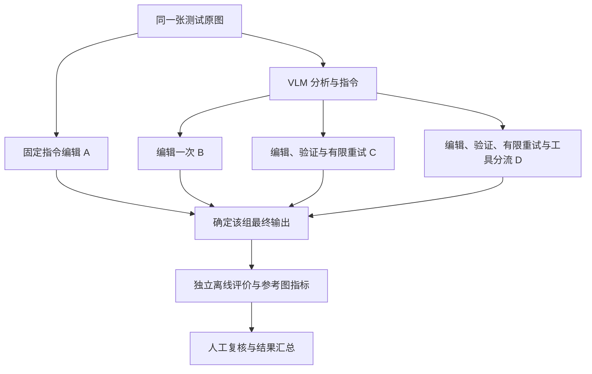

# AgentRestoration 实验设计说明

版本：v0.1  
日期：2026-11-17  
依据：需求文档、当前实验脚本、已保存的 48 组真实试运行记录  
配套文档：[实验操作流程](实验操作流程.md)、[实验记录](实验记录.md)

## 1. 实验为什么存在

处理系统负责修复图片，实验系统负责检查这些设计是否有收益。仅展示一张修复成功的图片，无法说明分析指令、验证重试或工具回退是否有效，也无法发现系统是否误接受了内容被改动的图片。

本项目研究的问题是：相比直接调用图像编辑模型，加入退化分析、结构检查、反馈重试和专用工具回退，能否改善修复质量，并减少明显错误修改？实验同时观察效果、结构错误、自动接受、调用次数与耗时，不以单个指标替代整体判断。

目前完成的是**合成高斯噪声任务的小规模试运行**。运行成功说明实现和评测链路已经接通，不代表已证明整个系统在真实噪声、模糊、低光或去雾任务上有效。

## 2. 三种验证工作的区别

| 工作 | 目的 | 证据 | 当前情况 |
| --- | --- | --- | --- |
| 程序测试 | 检查匹配、计数、分流、错误处理是否按规则执行 | pytest 测试和模拟适配器 | 2026-11-17 检查：41 项通过 |
| 工具与接口联调 | 确认真实 API、真实权重能执行 | 请求记录、实际图片、独立去噪输出 | 已接通 Qwen 和 Restormer |
| 四组实验 | 比较不同修复方案的行为和结果 | 同一测试集上的 A/B/C/D 记录与人工复核 | 已完成 48 组试运行，人工复核待完成 |

模拟测试不能充当真实修复实验；真实请求成功也不能自动算作图像质量改善。三种证据应分别报告。

## 3. 四组方案与比较目的

实验分组只存在于本目录。A/B 由实验基线流程执行，C/D 调用系统闭环，C 在实验层禁用工具回退。系统命令行和系统流程都不接收分组参数。

| 组别 | 修复前 VLM 分析 | 在线结构与效果验证 | 质量反馈重试 | 专用工具回退 | 比较目的 |
| --- | --- | --- | --- | --- | --- |
| A | 无 | 无 | 无 | 无 | 固定指令直接编辑的基线 |
| B | 有 | 无 | 无 | 无 | 与 A 比较，观察针对性指令的影响 |
| C | 有 | 有 | 最多一次 | 无 | 与 B 比较，观察验证及反馈的影响 |
| D | 有 | 有 | 在额度内执行 | 最多一次 | 与 C 比较，观察适应性分流与回退的影响 |

A 使用实验目录中的固定质量改善指令；B/C/D 使用 VLM 针对输入图生成的指令。四组均读取同一份测试清单，每组分别发送请求，**不共用第一张候选图**。

正常成功路径中 A、B 各调用编辑接口一次。实验专用基线控制器在接口执行失败后仍可能消耗剩余编辑额度，属于执行错误处理，不属于质量反馈重试；本次 A、B 实际均为每图一次，没有触发这种分支。所有组每任务已发送的编辑请求都受两次硬上限约束。

C、D 的重试指令由初始指令与结构失败信息、VLM 返回的修订建议组合生成。路线由程序规则选择，不另设一个自由决策的 LLM，也不通过额外的指令改写循环绕过次数限制。

### 3.1 各组流程

“独立离线评价”表示在生成流程之外额外执行评价，不表示使用了独立模型或独立评审人员。当前在线验证与离线 VLM 评价使用同一个模型，因此存在共同判断偏差。

### 3.2 C、D 的在线流程

每个候选先检查宽高比，再检查主要目标匹配与归一化位置；明确的结构失败直接分流，其余情况交 VLM 比较原图与候选。只有明确改善且保持内容才接受，无法确认不能自动通过。

D 的分流顺序为：严重结构错误且有未使用的适用工具时优先工具；否则使用剩余编辑额度；编辑额度耗尽后仍可使用尚未执行的适用工具；无可用路线则停止。工具输出也要验证，工具失败后如仍有编辑额度，可以回到编辑路线。

所有编辑重试与工具流程均从保存的基准原图开始。专用流程最多启动一次，报错也占用额度。图像编辑请求发送后，无论成功、报错或超时都计数。

## 4. 数据集、配对和划分

本轮读取以下目录，不改写源文件：

- 输入：`F:\cvlab\datasets\test-data\denoising_testsets\CBSD68_25`
- 参考：`F:\cvlab\datasets\test-data\denoising_testsets\CBSD68`

实验将该目录作为已知合成高斯去噪任务使用。目录后缀 `25` 是数据命名，程序没有重新合成这些噪声，也不能仅凭目录名证明其生成参数。

选择方法为：按输入文件名排序 → 保留存在同名参考图的 PNG → 使用 Python 随机种子 `20261112` 打乱 → 取前 20 个场景 → 前 8 个用于校准、后 12 个用于测试。原图与参考图路径、SHA256 和划分保存在 `experiments/manifest.json`。

| 用途 | 场景 ID |
| --- | --- |
| 校准，8 张 | 182053、260058、291000、285079、21077、223061、219090、167083 |
| 测试，12 张 | 101085、145086、14037、216081、241048、103070、105025、296059、119082、16077、143090、196073 |

同一场景不能同时用于校准和正式评价，不同噪声版本也不能跨集合。本次没有使用 Rain100L、SOTS 或低光数据完成四组实验，不将结论推广到这些任务。

配对先检查同名与尺寸，再使用低频空间差异、噪声残差均值和均方根检查数值一致性，本次 20/20 通过。具体数值位于 `experiments/pairing_checks.json`。这些是辅助一致性检查，不等于已完成人工内容标注。

## 5. 模型与控制变量

| 项目 | 本轮使用情况 |
| --- | --- |
| 图像编辑 | `qwen-image-2.1-turbo`，每次生成一张候选 |
| 分析与评价 | `qwen3-vl-plus`，结构化 JSON 返回 |
| 目标检测 | YOLO11n，同一模型与检测配置 |
| 专用工具 | Restormer 彩色盲高斯去噪权重，BiasFree 网络配置 |
| 工具推理 | CPU，步长 224、边缘扩展 16 的分块推理，重叠区域平均 |
| 输入处理 | 保留上传原文件，另存 EXIF 方向校正后的 RGB 基准图 |
| 重试输入 | 基准原图，不使用失败候选作为下次输入 |
| 生成额度 | 编辑请求最多 2 次；工具流程最多 1 次 |
| 参考图用途 | 仅用于配对检查和评价，不传给修复模型或作为修复输入 |

权重来源、哈希和作者代码来源可查 `weights/sources.json`、`third_party/Restormer/source.json` 及任务记录。模型名可能是服务别名：实际返回版本不可获取时应写未知，不能声称已锁定不可变后端版本。

固定样本和配置不等于输出可逐像素复现。本轮没有锁定生成模型随机种子，也没有进行多次独立重复。A/B/C/D 的初始候选不同，因此 D 比 C 多接受几张，不能直接全部归因于工具回退。更严格的因果比较需要重复试验，或在单独设计并清楚标注的实验中共享初始候选。

## 6. 校准做了什么、没有做什么

校准脚本对 8 张校准输入分别生成亮度乘以 `1.1` 的控制图，检测原图与控制图，对匹配目标收集归一化中心位移。这仅检查内容保持情况下，亮度变化是否使检测框漂移。

当前位置通过阈值的计算为：

`position_pass = max(0.02, min(0.08, 位移的 95% 分位数 + 0.01))`

严重位置阈值取 `max(0.12, 3 × position_pass)`，最大匹配距离取 `max(0.3, position_severe)`。匹配对象少于 3 个时，当前脚本停止并记录证据不足；**3 个是程序运行门槛，不是统计充分性的标准**。

本次仅得到 3 个可靠匹配，来自马、人和船三个场景。最终位置通过阈值为 `0.02`，由公式的工程下限决定，不能称为已在大量真实编辑错误上优化得到的阈值。

| 配置 | 本次四组记录中的数值 | 证据性质 |
| --- | --- | --- |
| 宽高比通过/严重阈值 | 0.01 / 0.05 | 工程初值，另有程序边界测试 |
| 检测置信度 | 0.5 | 工程初值 |
| 最小相对面积 | 0.01 | 工程初值 |
| 最多目标数 | 20 | 复杂度限制 |
| 位置通过/严重阈值 | 0.02 / 0.12 | 有限亮度控制数据及工程公式 |
| 最大匹配距离 | 0.3 | 工程公式 |

配置状态为 `pilot_calibrated_limited_brightness_controls`。目前没有系统校准所有置信度、面积、增删可靠性与严重阈值，也没有用充分的人工标注验证误接受/误拒绝。因此本轮结果应称为试运行结果。

## 7. 在线决策与离线评价

### 7.1 在线接受

在线接受是 C、D 在生成流程中的决策，决定是否交付候选。A、B 没有在线质量门控，`accepted=null`，不能把 `baseline_completed` 解释为验证通过。

C、D 全部候选未通过时，最终输出回到原图，状态为 `needs_review`；这与接口或工具的 `execution_failed` 不同。报告质量时应同时观察“保守输出减少错误”和“是否真的改善了退化”，避免把始终返回原图当作优秀修复系统。

### 7.2 离线评价

四组每个任务完成后，实验脚本对该任务的最终输出再做一次结构检查和 VLM 比较。这次评价不改变已经完成的在线决策，因此同一任务可能在线拒绝、离线接受，或反之；两者不能混成同一个接受率。

离线评价对 A/B 也执行，所以四组有统一的 VLM 评价口径。但同一模型重复判断可能波动，仍需要人工复核，不能用离线 VLM 分数证明系统正确。

### 7.3 参考图指标

代码读取输出与参考图并转成 RGB，仅当形状相同时计算 PSNR、SSIM，像素范围为 0—255，SSIM 使用彩色通道模式。形状不同则写空值和 `dimensions_differ`，不拉伸、裁剪或人为对齐凑数。

PSNR 越高表示像素均方误差越小，SSIM 反映局部结构相似性；二者都不能独立证明语义内容完全保真。原图输入指标也保存在 `input_metrics`，方便判断最终输出是否改善。

本次可计算指标的样本是：A=0、B=0、C=6、D=4。C 的 6 个都是返回原图的任务；D 的 4 个包含 3 个返回原图任务及 1 个接受结果。**因此当前各组均值不构成公平的修复质量排名，也不能凭 D 的均值较高就认定 D 更好。**

## 8. 统计口径

| 指标 | 定义与边界 |
| --- | --- |
| 在线自动接受率 | C/D 中 `accepted=true` 的任务数除以该组有效生成任务数；当前每组分母 12。A/B 不适用 |
| 工具回退比例 | 启动过工具流程的任务数除以 D 组任务数，包含启动后失败的情况，不等于工具成功率 |
| 编辑调用数 | 已发送请求数，包含超时和错误请求；额度预留无法确认是否已发送时保守占用 |
| VLM 调用数 | 由事件中的 `api_request`、`kind=vlm` 统计；修复前分析、在线验证和离线评价都可能产生调用，不属于编辑额度 |
| 耗时 | `elapsed_seconds` 为单图生成流程耗时，包含流程中的分析、检查、重试和工具执行；不包含构造客户端/检测器及后续离线评价的全部时间 |
| 人工结构错误率 | 每组最终输出中，人工作出明确判断且存在大尺度内容错误的任务占比；未确定样本另报，不默认为无错误 |
| 误接受 | 在线已接受，但人工认为不应接受；A/B 没有在线门控，不适用该概念 |
| 含误拒绝任务 | 某 C/D 任务至少有一个被拒候选，经人工判断其实可接受；必须查看候选，不能只看最终返回的原图 |

接口执行失败应单列数量和原因，不能从报告中悄悄删除。当前实验驱动遇到生成流程执行失败会保存部分记录并停止，尚不提供自动续跑或完整失败队列功能。

## 9. 本次实际结果与解释

本次 12 张测试图各运行四组，共 48 个任务，结果以 `experiments/results.json` 为准：

| 组别 | 任务数 | 编辑请求 | 工具启动 | 在线自动接受 |
| --- | --- | --- | --- | --- |
| A | 12 | 12 | 0 | 不适用 |
| B | 12 | 12 | 0 | 不适用 |
| C | 12 | 20 | 0 | 6/12 |
| D | 12 | 18 | 5 | 9/12 |

这 48 个任务共发送 62 次编辑请求、启动 5 次工具流程。独立接口联调、工具冒烟测试及额外校准图运行不包括在这 48 个任务的统计中。详细耗时、指标与离线结论见 [实验记录](实验记录.md)。

现阶段可以说明四组执行链路已跑通，能够记录接受、保守拒绝和工具分流。不能仅凭这些数字证明工具回退使真实质量提高、错误率下降或系统具有统计显著优势。

## 10. 历史试运行与当前实现的关系

48 组任务由同一实验进程按启动时加载的实现顺序执行。实验期间，命令行版本又补充了工具子进程隔离、显式高斯任务选择、高置信度计数规则和运行元数据记录，并进行了单独测试与联调。

所以，现有结果是当时试运行实现的证据，**不是最终加固版本的完整重跑基准**。现有任务保存了配置与调用记录，但未保存完整的启动时代码快照；不能保证用当前源码逐项精确重现历史行为。再次执行当前脚本属于新一轮实验，应另行归档和标记版本。

## 11. 后续成为正式实验的条件

1. 人工检查场景配对并完成最终图与候选的复核，记录不确定标签。
2. 在独立校准集补足可靠对象与真实错误样本，验证增删、移动、宽高比及严重程度阈值，而非只验证亮度漂移。
3. 冻结源码、依赖、权重、配置和提示词版本，归档后用该实现完整运行四组。
4. 统一输出空间评价协议，或明确以人工比较为主；不能基于当前不同指标子集作组间排名。
5. 视实验目标增加独立重复，区分随机生成差异和方法收益。扩展到其他退化时，应补对应数据、适用工具和单独结果。

本次文档补充仅整理设计、流程与已有证据，不代表上述待完成项目已经执行。
