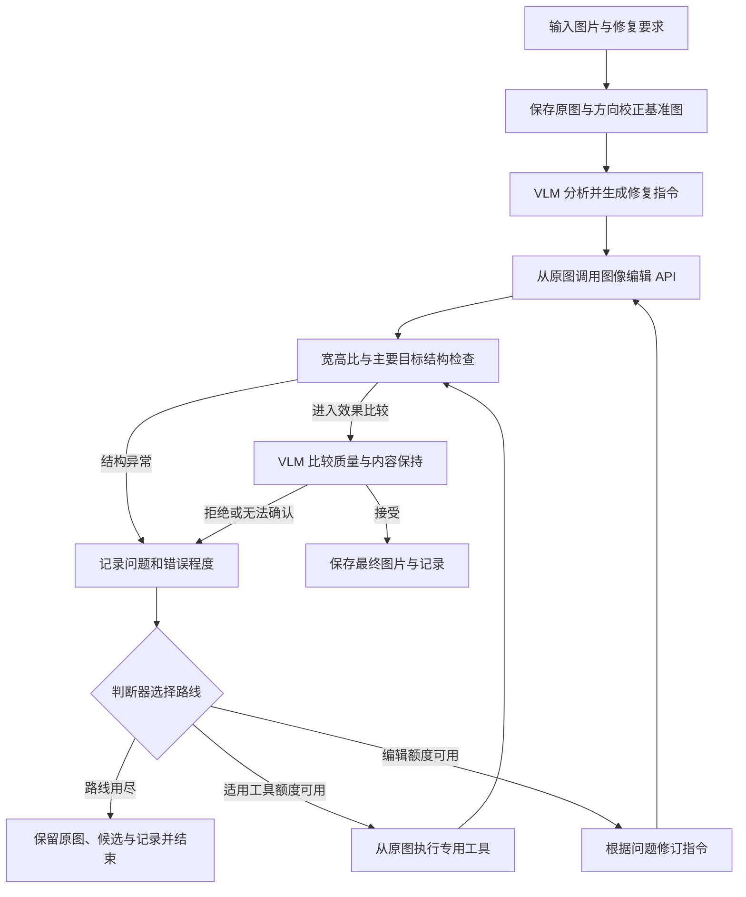

# AgentRestoration 需求文档

版本：v0.4

日期：2026-11-22
用途：《图像与视频处理》课程大作业，选题 4：Agentic Image Processing  
项目目录：`F:\Agentrestoration`

## 1. 项目目标

构建通过现成 API 与预训练工具进行图像修复的智能体系统。系统分析图像退化，生成修复指令，执行编辑，检查结构与修复效果，并根据验证结果选择接受、重试或专用工具回退。

修复过程保留原始内容、构图与主要目标位置。每次任务保存原图、候选、验证结果和路线记录，支持结果查看与处理复查。

系统入口执行完整单图闭环；对比实验、校准和评测由独立的 `experiments/` 目录组织。

## 2. 当前功能

| 功能 | 要求 |
| --- | --- |
| 单张图片处理 | 接收图片与修复要求，完成分析、修复、验证和保存 |
| VLM 分析 | 输出退化类型、程度、修复目标与指令 |
| 图像编辑 | 根据原图和指令生成候选图片 |
| 结构检查 | 比较宽高比、主要目标数量与归一化位置 |
| 效果验证 | 比较原图和候选，判断质量改善与内容保持 |
| 反馈与分流 | 根据问题、错误程度、工具适用性和剩余额度选择路线 |
| 任务记录 | 保存图片、指令、配置、验证、计数和执行事件 |
| 过程可视化 | 展示阶段、图片、检测框、验证结论与路线 |
| 多轮修改 | 选择已有候选，输入新要求，以所选图片开始下一轮 |

## 3. 用户操作

1. 提供 JPG/JPEG 或 PNG 图片，可填写修复要求。
2. 启动处理。默认要求为改善质量并保持原始内容、构图和物体位置。
3. 系统自动执行分析、编辑、验证和路线选择。
4. 查看当前图片、其他候选和处理记录；可下载所选图片。
5. 选中一张候选，填写新的要求，点击“基于所选图片继续修改”；可通过轮次选择器回看历史。

当前命令行接收图片路径、修复要求、配置文件、输出目录和任务类型。`auto` 根据分析执行修复闭环，并为明确的低光或雾退化选择对应工具；`gaussian_denoising`、`low_light`、`dehazing` 分别启用合成高斯去噪、低光增强、去雾回退。工具选择同时匹配任务类型和退化分析。

本地界面由左侧操作栏、右上方图片区和右下方流程区组成。左侧约占 22%，用于选择图片与输入要求；图片区并排展示本轮输入和所选候选，使用相同展示高度；下方白色面板按每次尝试横向展示处理流程，重试与工具回退各占一行。节点详情点击展开。

每轮优先展示通过验证的结果；本轮未通过时展示最后一张有效候选，其余候选折叠，用户可选择任意一张继续修改。没有有效候选时展示本轮原图。首次编辑通过即可结束本轮。

后续轮次以用户选中的图片作为新的基准图，保存新要求及来源关系，独立管理两次编辑和一次工具额度。局部修复可沿用区域或在所选候选上重新框选。

## 4. 组件与分工

| 组件 | 当前配置 | 职责 |
| --- | --- | --- |
| VLM | Qwen 官方 API，`qwen3-vl-plus` | 分析退化、生成指令、比较原图与候选 |
| 图像编辑 | Qwen 官方 API，`qwen-image-2.1-turbo` | 生成修复候选 |
| 目标检测 | YOLO11n | 提供类别、检测框、置信度、位置与面积 |
| 专用工具 | Restormer、Retinexformer、DehazeFormer | 执行合成高斯去噪、低光增强、去雾回退 |
| 判断器 | 程序规则 | 根据验证结果与剩余额度选择路线 |
| 流程控制 | Python 核心程序 | 管理阶段、调用计数、状态和产物 |
| 工具进程 | 独立 Python 子进程 | 加载权重、执行分块推理并返回候选 |

模型、地址、阈值、超时、设备和工具路径通过配置管理。专用工具按任务类型和分析结果选择。

## 5. 处理闭环

### 5.1 路线优先级

| 顺序 | 条件 | 动作 |
| --- | --- | --- |
| 1 | 严重结构错误，且存在可用、适用的工具流程 | 优先从原图执行专用工具 |
| 2 | 编辑请求尚有额度 | 结合问题修订指令，从原图重新编辑 |
| 3 | 编辑额度用满，仍有可用、适用的工具流程 | 从原图执行工具回退 |
| 4 | 可用路线已经用尽 | 保存原图、候选和记录，结束任务 |

工具输出重新进入相同验证流程。工具执行后若仍需继续处理，判断器根据剩余额度选择后续路线。效果无改善作为效果问题记录，结构异常按数值与目标变化分类。

### 5.2 调用额度

| 项目 | 规则 |
| --- | --- |
| 图像编辑 | 每任务最多 2 次，包含首次请求 |
| 专用工具 | 每任务最多启动 1 次工具流程 |
| 编辑计数 | 请求发送前持久化额度，已发送请求的报错与超时同样计数 |
| 工具计数 | 启动前持久化额度，执行报错与超时同样计数 |
| VLM | 在分析与候选验证阶段调用，对配置的网络错误有限重试 |
| 图片下载 | 对同一次生成结果进行有限下载重试 |
| 处理输入 | 编辑重试和工具回退均使用保存的基准原图 |
| 提前结束 | 候选明确通过时接受并结束 |

## 6. 结构检查

### 6.1 原图基准与宽高比

保存上传原文件，完成 EXIF 方向校正后生成基准图。目标位置与结构比较统一使用基准图坐标。编辑输入超过体积配置时，另存经过压缩或等比例缩小的发送副本，并记录实际发送参数。

设基准图宽高为 `W₀、H₀`，候选图宽高为 `W₁、H₁`：

`e = abs((W₁ / H₁) / (W₀ / H₀) - 1)`

默认 `e < 0.01` 时进入目标检查，`e ≥ 0.01` 时记录宽高比异常并分流。允许分辨率变化，等比例尺寸变化按相同宽高比处理；候选按原始输出尺寸参加检查。

### 6.2 主要目标

1. 基准图与候选使用同一检测器及配置。
2. 按置信度、相对面积和目标数配置筛选主要目标。
3. 同类目标按归一化中心距离建立一对一匹配。
4. 记录匹配目标的位移、未匹配目标及判断依据。
5. 超过位置阈值时记录结构异常，达到严重阈值时按严重问题分流。
6. 对具有可靠依据的未匹配目标记录疑似增删；其余检测证据交 VLM 复核。

中心坐标使用 `(中心 x / 图宽, 中心 y / 图高)`，位移采用归一化中心的欧氏距离。结构检查返回 `pass`、`fail` 或 `uncertain`，附带原因与数值。

### 6.3 系统默认参数

| 参数 | 默认值 |
| --- | --- |
| 宽高比通过 / 严重阈值 | 0.01 / 0.05 |
| 检测置信度 | 0.5 |
| 最小目标相对面积 | 0.01 |
| 最大主要目标数 | 20 |
| 位置通过 / 严重阈值 | 0.04 / 0.12 |
| 最大匹配距离 | 0.3 |
| 目标数量变化可靠性阈值 | 0.9 |

通过阈值、严重阈值和匹配范围在配置中统一管理，严重阈值大于或等于对应通过阈值。任务记录保存实际使用的参数。

## 7. VLM 分析与效果验证

### 7.1 分析输出

结构化分析包含退化类型、严重程度、确定性、修复目标、保留内容和编辑指令。退化类型包括噪声、模糊、低光、雾及其他。

### 7.2 验证输出

同时传入原图、候选和结构检查结果，分别判断：

- 目标退化的改善程度，以及平滑、锐化、颜色等处理效果。
- 主要内容、物体位置、构图和几何关系的保持情况。
- 接受、拒绝或无法确认，并提供问题列表、简短理由和重试建议。

接受条件为：结论为接受、质量明确改善、结构明确保持。明确的程序结构异常直接进入分流，其他情况执行双图比较。
外观变化还需明确属于正常修复或用户要求的变化。验证依据用户原始要求，结合选区、全图及色块证据；明显的未授权背景替换或色块属于异常。证据与正常修复结论冲突时标记为无法确认，继续使用既有路线和调用上限。

### 7.3 结构化返回处理

使用 Pydantic 校验分析和验证字段。解析错误记录为执行问题；质量与结构判断记录为验证结果。保存结构化结论、简短理由、测量值、阈值、错误程度及路线选择。

## 8. 文件、配置与结果状态

每任务在 `runs/<任务ID>/` 保存上传原文件、基准图、分析、编辑候选、工具候选和最终输出，在 `log/tasks/<同一任务ID>/` 保存过程日志与完整任务记录。任务 ID 由时间与随机标识组成。

| 状态 | 含义与输出 |
| --- | --- |
| `completed` | 候选通过验证，生成 `final.png` |
| `needs_review` | 路线用尽后保留原图与候选，提供复核记录 |
| `execution_failed` | 记录输入、接口或工具执行错误，以及已产生的文件 |

`record.log` 使用 JSON 汇总输入、配置、候选、检查、结论、路线、计数、版本和耗时；`events.log` 每行记录一个 JSON 阶段或请求事件。图片目录由 `artifact_directory` 关联，最终输出由 `output` 字段定位。实验和联调记录使用各自目录中的原有文件。

每次实际发送的编辑指令写入 `prompts/image_n.txt`，并在 `edit_requests` 中关联调用序号、候选和请求状态。流程节点及执行结果保存在 `steps` 中。

API 地址、模型、超时、图片大小、结构阈值与工具路径集中配置。凭据通过环境变量或本地配置读取；版本管理与任务导出分别管理源码、配置、模型资产和运行产物。

对图片格式、大小、解码、接口响应和工具执行进行校验，记录具体状态和错误类型。

## 9. 过程可视化

过程可视化展示当前阶段、原图与候选、编辑或工具来源、指令、检测框、结构结果、效果结论、路线和调用计数。总处理耗时保存在处理记录中。

流程节点使用绿色表示成功、红色表示未通过或需复核、蓝色表示进行中、灰色表示等待或跳过。重试和工具回退分别展开节点；界面支持候选切换、检测框开关、实际指令查看，以及图片和记录下载。

处理期间禁用输入、轮次切换与开始按钮。完成后可切换候选、下载当前选中的图片与 JSON 格式的 `record.log` 处理记录，并填写新要求继续修改。候选的验证状态独立于用户选择；选中一张图片时保留其原验证结论。历史轮次保存在页面会话中，每轮文件和日志独立保存，并记录来源任务、候选和输入哈希。

## 10. 验收标准

- 支持格式的单图可完成分析、编辑、验证、接受与保存。
- 宽高比异常进入分流，等比例尺寸变化通过宽高比检查。
- 主要目标匹配、位置变化和疑似增删有具体记录。
- 检测证据需复核时，进入 VLM 比较并给出明确状态。
- 严重结构问题优先选择适用工具，其余问题按剩余额度处理。
- 编辑请求计数最多两次，工具流程启动计数最多一次，错误与超时纳入计数。
- 工具结果经过完整验证，后续路线按剩余额度选择。
- 各候选和决策可追溯，原图及任务产物独立保存。
- 通过结果默认展示，其余候选折叠；没有通过结果时默认展示最后一张有效候选。
- 下一轮实际输入与所选图片一致，新要求、来源关系及每轮调用额度分别记录。
- 切换候选、回看历史和下载使用已保存结果，保持调用计数。
- 输入、接口、解析和工具执行错误有对应记录。
- 系统入口、实验驱动与运行产物按目录职责组织。

## 11. 项目与实验文档

代码目录与协作入口见 [项目结构](项目结构.md)，运行方式见 [README](README.md)，模块设计见 [开发方案](开发方案.md)。

实验驱动、校准、评价和结果统一位于 [实验目录](experiments/README.md)。实验设计与统计口径由该目录中的专门文档维护。

## 12. 参考工作

- AgenticIR：https://arxiv.org/abs/2410.17809
- RestoreAgent：https://arxiv.org/abs/2407.18035
- MAIR：https://arxiv.org/abs/2503.09403
- HarnessIR：https://arxiv.org/abs/2610.10133
