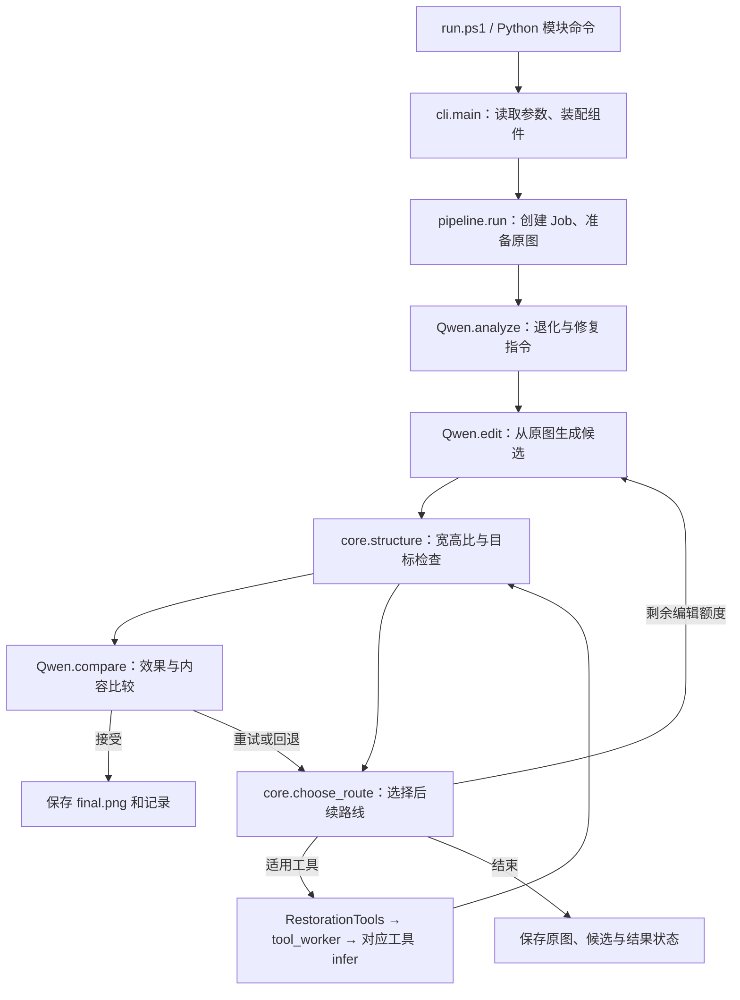

# AgentRestoration 项目结构与协作指南

日期：2026-11-17  
项目根目录：`F:\Agentrestoration`

## 1. 快速了解项目

AgentRestoration 是一个单图修复智能体。系统调用 Qwen 分析退化和编辑图片，使用 YOLO11n 与 VLM 检查候选，再选择接受、重试或专用工具回退。工具包括 Restormer 去噪、Retinexformer 低光增强和 DehazeFormer 去雾。

合作者可以按以下顺序阅读：

1. [README](README.md)：运行命令与配置方法。
2. [需求文档](需求文档.md)：功能、处理规则与验收标准。
3. 本文第 3—5 节：核心文件、调用关系和修改入口。
4. [开发方案](开发方案.md)：模块设计与实施安排。
5. [实验目录](experiments/README.md)：独立的对比实验与评价流程。

## 2. 目录结构

以下按职责展开代码与资料目录，运行产物以任务目录为单位保存。

```text
F:\Agentrestoration\
├─ README.md                         # 项目入口：安装、配置、运行
├─ 项目结构.md                        # 目录、调用关系与协作入口
├─ 需求文档.md                        # 功能需求与验收标准
├─ 开发方案.md                        # 模块设计与实施安排
├─ Agentrestoration.code-workspace   # 编辑器工作区
├─ pyproject.toml                    # 包定义、依赖、命令入口、测试配置
├─ requirements.lock.txt             # 本机依赖版本记录
├─ run.ps1                           # Windows 单图运行脚本
├─ run_ui.ps1                        # 本地可视化工作台启动脚本
├─ .env.example                      # 环境变量示例
├─ .gitignore                        # 版本管理忽略规则
├─ api.txt                           # 本地 API 凭据
│
├─ src/
│  └─ agentrestoration/              # 系统核心
│     ├─ __init__.py
│     ├─ cli.py                      # 命令行参数与组件装配
│     ├─ pipeline.py                 # 完整单图处理闭环
│     ├─ core.py                     # 配置、数据模型、任务记录、检查、分流
│     ├─ adapters.py                 # Qwen、YOLO11n、Restormer 适配器
│     ├─ restoration_tools.py        # 工具选择、Retinexformer、DehazeFormer 推理
│     └─ tool_worker.py              # 专用工具推理子进程
│
├─ ui/                              # 本地 Streamlit 界面
│  ├─ __init__.py
│  ├─ app.py                        # 三栏布局、上传、实时显示与下载
│  ├─ service.py                    # 界面到系统的组件装配与调用
│  └─ presentation.py               # 流程节点、预览检测框和指令展示
│
├─ configs/
│  └─ default.json                   # 系统默认模型、阈值与工具路径
│
├─ scripts/
│  └─ setup_assets.py                # 下载模型权重和作者代码
│
├─ tests/
│  ├─ test_core.py                   # 结构检查、计数、分流与闭环测试
│  ├─ test_api.py                    # API 计数与记录测试
│  ├─ test_interfaces.py             # 系统入口与实验调用边界测试
│  ├─ test_progress.py               # 实际指令、阶段事件与回调测试
│  ├─ test_ui.py                     # 三栏界面、颜色、预览与交互测试
│  └─ results.xml                    # 最近一次测试结果
│
├─ experiments/                     # 独立实验
│  ├─ __init__.py
│  ├─ README.md                      # 实验入口
│  ├─ 实验设计说明.md                 # 研究问题、分组和评价口径
│  ├─ 实验操作流程.md                 # 样本、校准、运行、汇总与复核
│  ├─ 实验记录.md                     # 已有实验结果
│  ├─ runner.py                      # 样本划分、校准、四组运行与指标
│  ├─ pipeline.py                    # 实验基线与分组组织
│  ├─ verify_pairs.py                # 输入与参考图配对检查
│  ├─ report.py                      # 实验汇总与复核表生成
│  ├─ tool_smoke.py                  # 专用工具独立推理验证
│  ├─ check_restoration_tool.py      # 按任务验证三种工具的真实推理
│  ├─ 工具接入验证.md                # 新增工具的推理与回归记录
│  ├─ manifest.json                  # 场景、路径、哈希与集合划分
│  ├─ pairing_checks.json            # 配对检查结果
│  ├─ calibration.json               # 校准记录
│  ├─ frozen_config.json             # 实验配置快照
│  ├─ results.json                   # 四组结果及任务目录索引
│  ├─ human_review.csv               # 人工复核表
│  ├─ tool_smoke.json                # 工具验证结果索引
│  ├─ calibration/                   # 校准图片
│  └─ runs/                          # 实验任务产物
│
├─ weights/
│  ├─ yolo11n.pt                     # 目标检测权重
│  ├─ gaussian_color_denoising_blind.pth
│  ├─ retinexformer_lol_v1.pth        # 低光增强权重
│  ├─ dehazeformer_mct_mixed.pth      # 混合数据去雾权重
│  └─ sources.json                   # 去噪权重来源与哈希
│
├─ third_party/
│  ├─ Restormer/                     # 架构、许可、来源记录
│  ├─ Retinexformer/                 # 架构、许可、来源与权重哈希
│  └─ DehazeFormer/                  # MCT 架构、许可、来源与兼容改动
│
├─ runs/                             # 系统单图任务产物
├─ log/
│  └─ tasks/<任务ID>/                # 系统日志：events.log、record.log
├─ .venv/                            # 项目 Python 环境
├─ .cache/                           # 下载缓存、临时文件与框架缓存
└─ .pytest_cache/                    # 测试缓存
```

## 3. 核心文件职责

| 文件 | 主要对象或入口 | 职责 |
| --- | --- | --- |
| [cli.py](src/agentrestoration/cli.py) | `main()` | 读取图片、要求和配置，装配组件，启动任务并输出状态 |
| [ui/app.py](ui/app.py) | 页面入口 | 显示输入、图片与流程，管理单图会话和下载 |
| [ui/service.py](ui/service.py) | `execute()` | 装配核心组件，将界面输入和事件回调交给闭环 |
| [ui/presentation.py](ui/presentation.py) | 展示辅助函数 | 将阶段记录转换为流程图，生成检测框预览，关联实际指令 |
| [pipeline.py](src/agentrestoration/pipeline.py) | `run()` | 组织分析、编辑、验证、分流、工具执行和结果保存 |
| [core.py](src/agentrestoration/core.py) | `Settings` | 读取并校验模型、阈值、超时、任务类型和工具路径 |
| 同上 | `Analysis`、`Verdict`、`Degradation` | 定义 VLM 分析和验证的数据结构 |
| 同上 | `Job` | 创建任务目录、记录事件、保存配置与管理调用额度 |
| 同上 | `prepare()` | 保存上传文件，处理 EXIF 方向并生成基准图 |
| 同上 | `structure()` | 检查宽高比、目标对应关系和归一化位移 |
| 同上 | `choose_route()` | 根据错误程度、适用工具和剩余额度选择路线 |
| [adapters.py](src/agentrestoration/adapters.py) | `Qwen` | 调用识图与编辑接口，解析结构化结果并下载候选 |
| 同上 | `Detector` | 执行 YOLO11n 检测，输出类别、框、置信度、位置与面积 |
| 同上 | `Restormer` | 判断工具适用性，启动推理子进程，执行分块去噪 |
| [restoration_tools.py](src/agentrestoration/restoration_tools.py) | `RestorationTools` | 按任务、退化程度及资产状态选择专用工具 |
| 同上 | `Retinexformer`、`DehazeFormer` | 低光增强与去雾，加载作者权重并执行分块推理 |
| [tool_worker.py](src/agentrestoration/tool_worker.py) | 模块入口 | 加载配置和权重，运行工具并保存推理元数据 |

## 4. 一次任务如何流转



宽高比和明确的目标结构异常直接进入分流；其余情况进入双图效果比较。任务过程由 `Job.event()` 记录，`Job.save()` 更新汇总。图中回路由编辑两次、工具一次的额度管理控制。

核心调用为：

```python
job = run(image_path, requirement, settings, api, detector, tool, output="runs", on_event=None)
```

该接口执行完整修复闭环。命令行保留图片、要求、配置、输出目录和任务类型五类输入。

`run_ui.ps1` 启动本地工作台，`ui.service.execute()` 调用同一个闭环。`on_event(event, snapshot)` 接收持久化后的阶段事件与独立数据快照，界面同步更新流程、图片和计数。回调的展示异常独立记录，处理路线仍由核心程序管理。

### 组件约定

| 组件 | 接口 | 返回 |
| --- | --- | --- |
| 识图服务 | `analyze(original, requirement, job)` | `Analysis` |
| 编辑服务 | `edit(original, prompt, job)` | 候选图片路径 |
| 效果验证 | `compare(original, candidate, checks, job)` | `Verdict` |
| 目标检测 | `detect(image)` | 目标列表 |
| 专用工具 | `available(analysis)` | 任务是否适用且资产就绪 |
| 专用工具 | `run(original, job)` | 工具候选图片路径 |

编辑适配器在发送请求前调用 `job.reserve("image")`；流程控制在启动工具前调用 `job.reserve("tool")`。工具子进程负责推理，父进程负责额度与最终验证。

## 5. 修改需求时从哪里入手

| 修改内容 | 首选位置 | 对应测试 |
| --- | --- | --- |
| 命令行参数和显示 | `cli.py`、`run.ps1` | `test_interfaces.py` |
| 三栏界面、流程图和图片预览 | `ui/`、`run_ui.ps1` | `test_ui.py` |
| 阶段事件与实际指令记录 | `core.Job`、`pipeline.run`、`adapters.Qwen` | `test_progress.py` |
| 模型名、地址、阈值和工具路径 | `configs/default.json`、`core.Settings` | 配置和结构检查测试 |
| 分析提示词、编辑协议、验证提示词 | `adapters.Qwen`、`core.Analysis`、`core.Verdict` | `test_api.py`、结构化返回测试 |
| 目标筛选、匹配与位移计算 | `adapters.Detector`、`core.structure` | `test_core.py` |
| 分流优先级 | `core.choose_route` | 路线与额度测试 |
| 整体阶段顺序和结果状态 | `pipeline.run` | 完整闭环测试 |
| 专用工具或权重 | `restoration_tools.py`、`adapters.py`、`tool_worker.py`、`setup_assets.py` | `test_restoration_tools.py`、工具推理与闭环测试 |
| 对比方案、样本和评价指标 | `experiments/` | 实验说明与实验层调用测试 |

## 6. 系统与实验的组织关系

`src/agentrestoration/` 提供完整修复能力。`experiments/` 导入系统组件来组织对比方案和评价：A/B 使用实验基线流程，C/D 调用系统闭环，C 由实验层提供关闭回退的工具适配器。

系统图片和指令写入根目录 `runs/`，系统日志集中在 `log/tasks/`。实验运行结果与 JSON、JSONL 记录仍写入 `experiments/runs/`。已有实验通过 `experiments/results.json` 关联场景、组别和图片目录。

## 7. 任务目录与主要配置

单次任务的文件布局如下：

```text
runs/<任务ID>/
├─ original_upload.<ext>    # 上传原文件
├─ original_normalized.png # 方向校正后的基准图
├─ analysis.json           # 退化分析和修复指令
├─ prompts/
│  ├─ image_1.txt          # 首次实际编辑指令
│  └─ image_2.txt          # 重试实际编辑指令
├─ api_inputs/             # 为接口体积限制准备的发送图片
├─ image_1.png             # 首次编辑候选
├─ image_2.png             # 编辑重试候选
├─ tool_1.png              # 工具候选
├─ tool_config.json        # 工具执行配置
├─ tool_metadata.json      # 推理版本与参数
├─ tool_error.json         # 工具执行错误类型
└─ final.png               # 通过验证的最终图片
```

对应系统日志单独保存：

```text
log/tasks/<同一任务ID>/
├─ events.log              # 每行一个 JSON 事件，追加写入
└─ record.log              # JSON 格式的完整任务记录
```

候选和工具文件随实际执行路线生成。`record.log` 中的 `artifact_directory` 关联图片目录，`output` 指向该目录内的最终输出；`record_file`、`events_file` 记录日志文件路径。

`record.log` 中的 `steps` 保存各次尝试的流程节点及状态；`edit_requests` 保存调用序号、实际指令、指令文件、候选文件名和请求结果。`Job.record_path`、`Job.events_path` 为实际写入位置，界面依据任务快照中的 `record_file` 下载处理记录。

配置采用 `Settings` 默认值 → JSON 配置覆盖 → 模型名与地址环境变量覆盖；命令行 `--task` 再设置任务类型。密钥由独立凭据读取逻辑加载，`VLM_API_KEY`、`IMAGE_API_KEY` 优先于本地 `api.txt`。

主要参数包括模型地址与名称、宽高比和位置阈值、检测置信度、相对面积、匹配距离、工具路径、超时、设备和任务类型。系统默认配置位于 `configs/default.json`，实验配置快照位于 `experiments/frozen_config.json`。

## 8. 协作流程

1. 阅读 README 并用示例图片熟悉一次完整运行。
2. 按第 5 节定位模块，在对应测试中补充行为验证。
3. 运行系统测试，检查闭环与实验调用边界。
4. 提交源码、配置、测试和相关说明；运行目录、权重、缓存与本地凭据按 `.gitignore` 管理。

```powershell
Set-Location 'F:\Agentrestoration'
$env:PYTHONPATH='src'
.\.venv\Scripts\python.exe -m pytest -q
```
